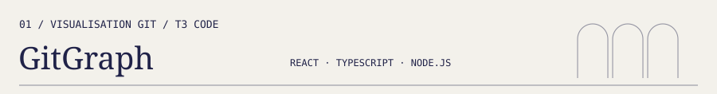
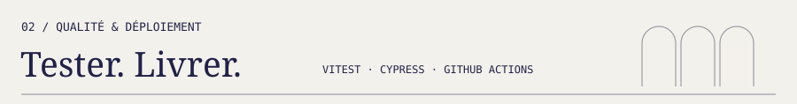
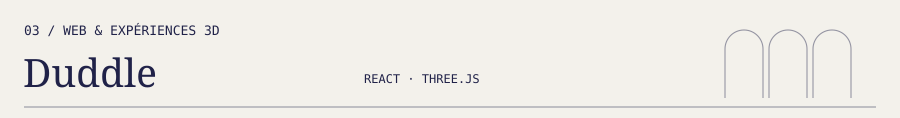
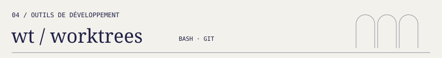

  

# Jean-Baptiste Sainte-Beuve

**Développeur web · React, Next.js, TypeScript et Symfony**

Basé à Cannes, je souhaite rejoindre une équipe de développement web. Mes projets couvrent les interfaces web, les API et l'automatisation des tests et des déploiements.

Interfaces web, expériences 3D, API et outils Git : voici quelques projets pour découvrir mon travail.

[LinkedIn](https://www.linkedin.com/in/jean-baptiste-sainte-beuve-42479a1b/) · [Mes dépôts](https://github.com/jbsaintebeuve?tab=repositories)

## Projets choisis

Visualiseur d'historique Git intégré au panneau Preview de T3 Code. Il affiche les branches et les merges, les détails et les différences entre commits, avec une actualisation en direct lorsque le dépôt change.

React · TypeScript · Node.js · Hono · SVG · Vitest

[Explorer le code et la documentation](https://github.com/jbsaintebeuve/gitgraph-for-t3code#readme)

Application d'inscription avec validation de formulaire. Le dépôt contient des tests Vitest et Cypress, ainsi que des workflows GitHub Actions pour compiler, tester et déployer l'application.

React · TypeScript · Vitest · Cypress · GitHub Actions · Vercel

[Explorer les workflows](https://github.com/jbsaintebeuve/ci-cd/tree/main/.github/workflows)

Landing page pour une boutique de stickers avec un mur 3D interactif. Le projet associe une interface React, une scène Three.js et un parcours de placement de stickers.

React · Three.js · React Three Fiber · Sass · Vite

[Voir le site](https://duddle.vercel.app)

Outil en Bash pour créer et retrouver les worktrees Git associés aux branches. La commande `finish` vérifie les chemins exclus avant de rebaser la branche et propose un push avec `--force-with-lease`.

Bash · Git · Tests d'intégration · GitHub Actions

[Lire la documentation](https://github.com/jbsaintebeuve/wt#readme)

## Et aussi

- [Music Library](https://github.com/jbsaintebeuve/music_library) : API de bibliothèque musicale avec PHP, Symfony, API Platform, Doctrine et authentification JWT.
- [ng-harrypotter](https://github.com/jbsaintebeuve/ng-harrypotter) : projet Angular et TypeScript.

## Dans ma boîte à outils

- Interfaces web : JavaScript, TypeScript, React, Next.js, Angular, Tailwind CSS et Sass.
- API et données : Node.js, Hono, PHP, Symfony, API Platform et Doctrine.
- Interactions 3D : Three.js et React Three Fiber.
- Tests et automatisation : Vitest, Cypress, GitHub Actions, Git et Bash.

## Me contacter pour un poste

Vous recrutez un développeur web ? Contactez-moi sur [LinkedIn](https://www.linkedin.com/in/jean-baptiste-sainte-beuve-42479a1b/) pour échanger sur le poste, votre équipe et les projets à construire.
